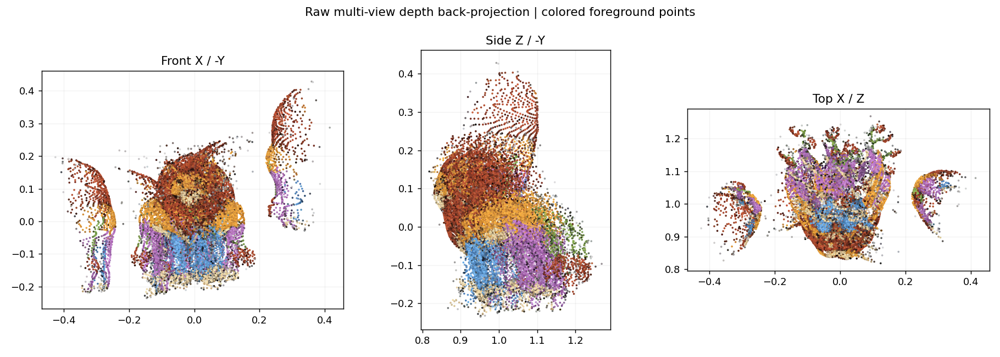
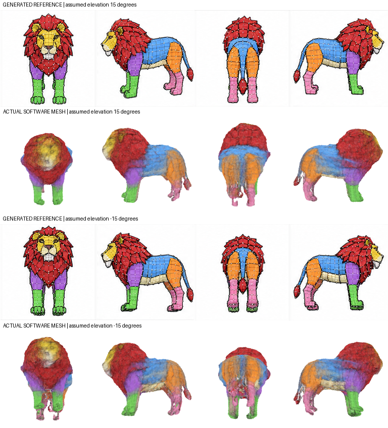

# Experiment journal

## Goal and rules

Turn one image-generation call into a decent 3D character using software, without manual agent modeling. Test competing approaches, commit coherent increments, record unsuccessful rounds, and distinguish generated drawings from measured geometry. Exact 1:1 reconstruction is not an assumed capability.

A successful experiment must include an actual mesh, inspected renders, quantitative checks, provenance, and explicit limits. An appealing atlas or GIF alone is not success. Reuse each generated input for software comparisons so generation and reconstruction changes are not confounded.

## 2026-11-05 · Repository inspection

- Starting revision: `34ed9eb` (README-only proposed workflow).
- Prior proposal used three eight-view sheets and an agent refinement phase. Neither was implemented.
- Replaced that proposal with an executable sixteen-view, one-sheet pipeline. Manual agent modeling was removed from the implementation and goal.
- Available runtime: Python/NumPy/SciPy/Pillow and Blender 4.3.2 CPU. No CUDA device or installed PyTorch was observed at this stage.

## Round 1 · Single generated wireframe/cel-shaded lion atlas

**Hypothesis:** one sixteen-view sheet contains enough shared silhouette information for a recognizable common 3D volume.

- One ImageGen call produced a 1261×1247 PNG with a 4×4 grid, nominally yaw 0° through 337.5° at 22.5° increments.
- Input SHA-256: `d6b6381b4baca46d19120e08795cfb8723e9150ac1dd4c27617a0e73593d64c4`.
- The image has painted wireframe lines and body-region colors. These are **appearance**, not decoded vertices, vertex IDs or calibrated depth.
- Cell splitting: rounded shared grid boundaries, two-pixel divider gutters, common square padding. No per-animal rescaling or recentering.
- Working masks: 192×192. Foreground from border-color distance, hole filling and tiny-speck rejection.
- Cameras: assumed level orthographic, scale 2, Z-up, fixed yaws. No measured camera recovery.
- Geometry: 80³ sampled field, signed silhouette distances, 0.6-voxel Gaussian smoothing, largest occupied component, marching tetrahedra.
- Compared all candidate tolerances on the same input:

| Allowed contradictory views per voxel | Minimum supporting views | Mean voxel-footprint silhouette IoU |
|---|---:|---:|
| 0 | 16 | 0.773258 |
| 1 | 15 | 0.835373 |
| 2 | 14 | 0.841801 |

The 14-of-16 candidate was selected for best mean image-space agreement. It had 61,317 occupied voxels; three connected occupied components before cleanup, with ten voxels discarded outside the largest component. No occupied voxel touched the grid boundary.

**Failure found:** the initial extractor removed triangles below an arbitrary area threshold, leaving four boundary edges. Two extremely small but valid triangles had been dropped. This was a software defect, not an image-generation failure.

## Round 2 · Fix tiny-triangle handling and validate actual mesh

**Change:** preserve nonzero triangles instead of rejecting them merely for small area. Reused the exact same generated input; **no second ImageGen call**.

- Final mesh: 54,160 vertices, 108,324 triangles, 162,486 unique edges.
- Boundary edges: 0. Nonmanifold edges: 0. Every counted edge has incidence 2.
- Signed volume: 0.953759 in arbitrary normalized units. Euler characteristic: -2. These checks do not establish anatomical quality or rule out self-intersections.
- Approximate color projection uses front-facing normals and a point z-buffer. Unobserved vertices receive neutral gray. No manually modeled anatomy or painted corrections.
- Blender exported the unchanged geometry to GLB and rendered 16 source yaws plus 16 unseen midpoint yaws. Actual mesh-ray depth and XYZ maps use the same geometry and cameras.
- Blender rendering/data/export took 6.659 seconds in this local run. Reconstruction before rendering took approximately eight seconds. These are observed timings, not general benchmarks.
- **Actual final-mesh silhouette IoU: mean 0.848219, worst view 0.764702.** Computed from pixel-center ray-intersection masks, separately from voxel selection scores.
- Generated a 32-frame turntable GIF with one shared palette, actual-mesh contact sheet, source-vs-mesh comparison and red/green/blue silhouette diagnostics.
- Inspected front and profile renders and all-view silhouette comparison. The lion is recognizable, but surface details are rough, facial texture and wireframe colors smear, and tail/legs/some outlines disagree with source views.
- Regression suite: 10 tests passed, including camera orientation, irregular atlas split, alpha/white-interior segmentation, known-consistent sphere carving, empty-hull failures, tolerance accounting and tiny-triangle closure.

**Renderer implementation checks:** Blender's bundled build lacks OpenImageDenoise; CPU denoising is explicitly disabled. A direct vertex-color-to-output material exports proper unlit GLB vertex colors, unlike the explicit Emission graph initially tested. A synthetic cube renderer fixture passed at level and elevated cameras; ray-map/render-alpha IoU was 1.0 for cardinal views and at least 0.9948 for the elevated midpoint checks. These primitive tests verify code, not the generated animal's correctness.

**Outcome:** working automatic one-generated-atlas-to-mesh baseline, with useful but visibly approximate results. This is not a 1:1 reconstruction, a retopologized asset, or an animation-ready character.

## Next investigations

- Learned multi-view depth and camera pose on this same atlas, with actual CPU/RAM feasibility and license checks.
- Compare reconstructed depth/correspondence quality before using it to fit geometry.
- Separate data derived from the fitted mesh from independent geometric evidence; do not reward self-consistency as if it proved truth.
- If testing a GIF input becomes supported, compare a locked-pose orbit against the static atlas and score the resulting mesh, not the apparent animation smoothness.

No learned-model result is claimed yet. Additional rounds should append actual commands/configuration, source/model versions, input hashes, test results, observed failures and whether another ImageGen call was used.

## Round 3 · Resolution and numerical robustness controls

Reused the original sheet; **no new ImageGen call**. Increased the field from 80³ to 128³ and expanded tolerance comparisons through four contradictory views.

- An early 128³ run exposed exact-zero and float32-coordinate degeneracies in marching tetrahedra. Exact level samples now use one shared vertex; coincident float32 positions are welded and only truly collapsed faces are removed. The repaired mesh has zero boundary/nonmanifold edges.
- Voxel-footprint rasterization previously left sparse diagonal gaps at some image/voxel resolution ratios. It now uses camera-basis-aware conservative footprints.
- That proxy can rank tolerances differently from actual mesh masks. At 128³ it selected one allowed miss, whose actual mean IoU was 0.840205. The explicitly evaluated two-miss mesh reached 0.848718. Added `--fixed-misses` so measured comparisons do not silently rely on the proxy winner.
- Matched comparison: 256×256 working and render images, exactly two misses, same source and cameras. 80³: 53,634 vertices / 107,276 triangles, mean actual IoU 0.846542, worst 0.760403. 128³: 143,776 vertices / 287,584 triangles, mean 0.848718, worst 0.770334.
- The approximately 2.7× triangle count buys only about 0.0022 mean overlap in this comparison. Extra resolution is not a solution to missing/contradictory geometric evidence.
- Added an executable end-to-end test for mesh export, real depth maps, GIF generation, caller-attested provenance and refusal to overwrite results. Added exact-level and float32-weld regressions.

[Higher-resolution output comparison](docs/experiments/02-resolution-control/reference-vs-mesh.png) · [Turntable](docs/experiments/02-resolution-control/turntable.gif)

## Round 4 · Software-predicted depth and pose on the original turnaround

Reused the original sheet; **no new ImageGen call**. Ran official Depth Anything 3 Small/Base on CPU, not image-generated depth. Six controls varied view count, input resolution, model size and reference selection.

- Small 16×308²: 6.399 seconds inference, 1156.4 MiB peak process RSS.
- Small 16×504²: 25.855 seconds, 1985.6 MiB.
- Base 16×308², first reference: 18.131 seconds, 2012.0 MiB.
- Base 16×308², automatic reference: 16.758 seconds, 1984.4 MiB.
- Every full-orbit raw cloud showed detached/duplicated surfaces and severe pose inconsistencies. Increased resolution/model size and automatic reference selection did not repair the orbit.
- These runs establish practical CPU inference, not successful full-mesh reconstruction. Predicted rotations are not ground-truth errors because the source cameras are uncalibrated.
- The raw fusion is rejected. Software depth may still be useful as confidence-gated constraints on one shared mesh with an explicit camera model.

Exact revisions, licenses, hashes, setup, controls and measured results: [learned-depth experiment](experiments/learned_depth/README.md). [Research survey](docs/research.md).

## Round 5 · One atlas with above/below camera bands

A second ImageGen call produced a single 1774×887, 8-column×4-row atlas. The first sixteen cells request a full orbit at +15° elevation; the next sixteen request the matching orbit at −15°. It contains part colors, visible wireframe and vertex-like dots. These marks are not decoded 3D vertices.

- Reconstructed upper-only, lower-only and combined views from the same atlas, with no per-view recentering/scaling and no manual geometry.
- Used 80³ fields, 192×192 masks/renders, and the same 12.5% miss tolerance: 2/16 for each single band, 4/32 combined.
- All three meshes have zero counted boundary or nonmanifold edges. Combined mesh: 47,684 vertices / 95,372 triangles.
- Upper-only fitted-band mean IoU: 0.806490. Its held-out lower-band score: 0.782265. Across all 32 views: 0.794378.
- Lower-only fitted-band mean IoU: 0.806622. Its held-out upper-band score: 0.764792. Across all 32 views: 0.785707.
- Combined mean IoU: 0.789783; worst view 0.650234. This is below the upper-only mesh's all-view score, so the additional constraints did not improve this controlled result.
- Visual inspection shows a recognizable but smeared lion, inconsistent rear/front transitions and uncertain camera spacing/elevation. Requested angles are not measured angles. Parts and character design also differ from the original atlas, so this is not a pure same-character comparison to Round 1.
- Added explicit camera manifests, multiple elevation bands, source-index-preserving subset tests, paired-band turntables and cross-view validation. Blender's Python exit code is explicitly set so render-script errors cannot masquerade as success.

[Input](docs/experiments/04-dual-elevation/input.png) · [Synchronized actual-mesh turntables](docs/experiments/04-dual-elevation/turntable-bands.gif)

## Clarification · Software depth, not painted depth

A proposed paired RGB/generated-depth sheet was superseded by the clarified objective: run **software depth estimation on the original turnaround**, and associate it with the same actual shared-mesh vertices. Generated grayscale values are not the requested depth source. No generated-depth reconstruction is accepted or claimed. One such input had already been generated; it is preserved as [an abandoned input](docs/experiments/05-abandoned-generated-depth/README.md), not a successful test. Total generation calls through this point: three, of which two supplied reconstruction inputs and one was abandoned.

Next: validate calibration/visibility/confidence for software-predicted depth before allowing it to deform the common mesh. Preserve vertex IDs in that mesh; do not claim identity correspondence for dots invented in separate source drawings.

## Published experiment evidence

Source and output visuals are versioned under [docs/experiments](docs/experiments), with hashes in [assets.json](docs/experiments/assets.json). Images and animated previews are included; mesh files, model weights, raw large arrays, environments and unrelated data are excluded. Machine-readable results and concise failed-experiment records are part of the journal, not just favorable screenshots.

## Round 6 · Learned complete-object prior (TripoSR)

Reused frontal and three-quarter crops from the original atlas, with no new generation. Unlike depth fusion, TripoSR conditions a learned whole-object prior on **one** view at a time.

- Frontal input: 19.69 s inference + 4.02 s extraction, 12,420 vertices / 24,836 triangles. A watertight but structurally incomplete mane-and-legs result. Rejected.
- Three-quarter input: 17.74 s + 3.63 s, 16,090 vertices / 32,176 triangles. Recognizable full lion with four legs/tail, rough surfaces/colors, inferred rear geometry and an untouched eight-face island. Useful comparison, not a faithful sixteen-view reconstruction.
- Used official MIT source/checkpoint, CPU float32, four threads, 128³ extraction, and a disclosed scikit-image marching-cubes adapter. No manual anatomy, smoothing or repair.
- Display-only uniform bbox normalization is not camera calibration. Meshes are retained locally; only previews and result metadata are published.

[Reproducibility and caveats](experiments/triposr/README.md) · [Frontal failure](docs/experiments/06-triposr/front-failure.gif) · [Three-quarter result](docs/experiments/06-triposr/three-quarter.gif)

## Round 7 · Software depth at shared mesh vertices

Reused the original atlas; **no new generation**. Compared DA3 Small/Base with independent Depth Anything V2 Small and recent lightweight ZipDepth. V2 estimated all sixteen views at518² in16.585 s/689.6 MiB peak RSS; ZipDepth at384² took1.013 s/413.8 MiB. These are finite depth maps, not automatically correct geometry.

1. Verified same-crop image registration and depth polarity.
2. Fit positive affine camera-z relationships on fitting pixels. For V2/ZipDepth, negated inverse-relative-depth is an explicitly approximate ordinal surrogate.
3. Rejected weak, sign-inconsistent or high-residual views. Original DA3 Small308 accepted views0–3 and12–15; rear-half views did not constrain deformation.
4. Preserved all54,160 actual mesh vertex IDs and108,324 faces. Painted source dots were never treated as proven common vertices.

**Failed normal-displacement attempt:** proposed motion flipped1,011 small triangles. Orientation-preserving line search reduced it to1/4096, effectively no useful change. Preserved as a failure record.

**Bounded smooth-field attempt:** a24³ displacement field, Gaussian smoothing, maximum node movement0.03 and conservative derivative bound0.25 allowed a nontrivial step with no flipped faces. Actual maximum DA3 movement0.01345, mean0.00579 normalized units. Geometry stayed edge-watertight with no nonmanifold edges.

| Prior | Spatial-assessment depth RMSE before → after | Actual silhouette mean IoU |
|---|---:|---:|
| Baseline | — | 0.848219 |
| DA3 Small308 | 0.056476 → 0.051446 | 0.847961 |
| V2 Small518 | 0.146960 → 0.142778 | 0.847312 |
| ZipDepth384 | 0.164873 → 0.160983 | 0.846467 |

All three improve agreement with their own depth priors but slightly worsen silhouettes. Visual changes are small. Different priors use different calibration/support; raw residual magnitudes are not a fair stand-alone ranking. Assessment blocks are excluded from fitting but used by view gates, and smooth warps couple nearby vertices: this is not blind independent validation or ground-truth3D accuracy.

[Method/scripts and limits](experiments/depth_fit/README.md) · [Before/after and unexaggerated displacement colors](docs/experiments/07-software-depth-fit/da3-before-after.png) · [Depth models](docs/experiments/07-software-depth-fit/depth-models.png)

## Round 8 · Coarse triangular pattern and region colors

A fourth generation call supplied one new16-view atlas referencing the original character. It replaced fine quadrilateral lines with coarse triangles and flat color regions. Actual colors remain broad body-part groups, not unique stable face/vertex IDs.

- Same80³,192px and14-of-16 hull settings:56,528 vertices /113,060 triangles, zero boundary/nonmanifold edges. Actual meanIoU0.847176, worst0.753353. Original was0.848219/worst0.764702: no improvement.
- Mutual SIFT/assumed-camera matching found284→279 mutual matches and230→213 geometry-gated matches. Exact three-view cycles increased10→21; only2→7 also met the triangulation agreement gate. Too sparse and uncertain to reconstruct every drawn vertex.
- Repeated DA3 Small308/V2 Small518/ZipDepth384 with identical software settings. Median normalized assessment residuals **worsened**: DA3 .223→.262, V2 .226→.256, ZipDepth .235→.267. Accepted views fell from8→6 for V2 and8→1 for ZipDepth; DA3 retained eight front-side views while rear correlations worsened.
- TripoSR on the same new three-quarter index:17.05 s inference +3.01 s extraction,29,830 triangles. Recognizable but still rough/patchy; coarse drawn lines became surface artifacts. No clear geometry improvement over the original input.
- The generation changed more than tessellation, so this is evidence against this **particular representation trial**, not a universal causal claim about triangles.

[Input](docs/experiments/08-coarse-pattern/input.png) · [Actual hull turntable](docs/experiments/08-coarse-pattern/turntable.gif) · [Feature matches](docs/experiments/08-coarse-pattern/sift-matches.png) · [Paired TripoSR comparison](docs/experiments/08-coarse-pattern/triposr-original-vs-pattern.gif)

The regression suite now includes a synthetic shared-vertex-warp check. Fifteen tests pass; optional learned-model runners are isolated from the baseline package. All model weights and meshes remain excluded from Git.

## Round 9 · Surface contour curves and fixed-vertex controls

A fifth generation call supplied a gray-clay lion with sparse black, red and blue surface-wrapping contours. It is a new drawing, so material, shape and framing changed alongside the line pattern. The goal remains our own reconstruction; TripoSR below is only a comparison.

- Same 80³ field, 192px masks and 14-of-16 tolerance: 55,334 vertices / 110,680 triangles, zero boundary/nonmanifold edges. Actual mean silhouette IoU 0.849804, worst 0.768072. This is only a small change from the original 0.848219.
- Repeated all three software-depth estimators. Median normalized spatial-assessment residuals for original → coarse triangles → contours: DA3 0.223 → 0.262 → 0.257; V2 0.226 → 0.256 → 0.234; ZipDepth 0.235 → 0.267 → 0.240. Contours recover some of the coarse-pattern loss, but none beats the original on this diagnostic.
- DA3 inferred a 174.27° jump between adjacent views 8 and 9. Its raw full-orbit cloud is rejected, regardless of improved self-reprojection statistics.
- Matched bounded shared-vertex fits also ran on coarse and contour inputs. Pattern DA3/V2 achieved silhouette IoU 0.846810/0.846512, slightly below their 0.847176 baseline. Pattern ZipDepth accepted only one view and was explicitly rejected before geometry export.
- Contour DA3/V2/ZipDepth field fits achieved IoU 0.849974/0.848945/0.848526. Their own spatial-assessment depth RMSE changed 0.079383→0.072158, 0.144994→0.141381, and 0.176179→0.172157. These remain small changes and are not ground-truth accuracy gains.
- The TripoSR contour comparison looks cleaner than its colored-wireframe controls: one watertight component, 17,013 vertices / 34,030 triangles. It still has rough facial details and is not part of the target reconstruction pipeline. No further TripoSR run was made for the dense-contour experiment.

[Input](docs/experiments/09-contours/input.png) · [Actual hull](docs/experiments/09-contours/turntable.gif) · [DA3 shared-vertex fit](docs/experiments/09-contours/da3-depth-fit.png) · [Comparison-only learned meshes](docs/experiments/09-contours/triposr-comparison-only.gif)

Full records: [contour software controls](experiments/contours/sparse-depth-control.md), [field-fit metrics](experiments/depth_fit/pattern-contour-field-results.json). All previous results remain intact.

## Round 10 · Dense high-contrast geometry contours

A sixth generation call supplied one white lion turnaround with many high-contrast black surface contours. The input has no useful texture requirement. The same automatic reconstruction and three depth estimators were run; no hand modeling or additional learned image-to-mesh inference was used.

- Baseline: 59,778 vertices / 119,560 triangles, zero boundary/nonmanifold edges; actual source-mask IoU 0.857248, worst 0.773716. This drawing has the strongest baseline outline agreement so far. Different source shapes mean it is not a controlled ground-truth geometry ranking.
- DA3 failed differently: all sixteen inferred cameras collapsed into a maximum pairwise rotation of only 12.87°. The resulting thin stacked slab is rejected. Its apparently favorable 1.26% self-depth disagreement is an example of misleading self-consistency.
- Fixed-camera calibration independently confirms weak DA3 depth: only views 8 and 12 pass, median normalized spatial-assessment residual 0.299. This fails the four-view minimum for downstream fitting. V2 accepts eight views with median residual 0.235; ZipDepth accepts five with 0.240. Those are candidates, not verified depth measurements.
- White interiors were checked explicitly: saved masks reproduce the threshold-and-hole-fill algorithm exactly. Of 248,762 foreground pixels, 49,320 are enclosed background-colored interiors; 46,937 remain in broad calibration support. The dense test did not accidentally use only black line pixels.
- Added geometry-only clay rendering with fixed white area lights, neutral gray rough material and flat existing triangle normals. It changes neither vertices nor faces. Numeric depth, XYZ, face IDs and mask arrays were identical between material modes in cube/sphere tests; default color renders pass pixel regression.
- Added a four-view minimum and explicit no-visible-support rejection to shared-vertex fitting. Sixteen regression tests pass, including rejection without writing geometry.

[Input](docs/experiments/10-dense-contours/input.png) · [Actual geometry-only turntable](docs/experiments/10-dense-contours/clay-turntable.gif) · [Software-depth maps](docs/experiments/10-dense-contours/software-depth-comparison.png) · [Rejected DA3 slab](docs/experiments/10-dense-contours/da3-collapsed-cloud.png)

[Detailed depth experiment](experiments/contours/dense-depth-control.md) · [Mask validation](experiments/depth_fit/dense-mask-validation.json)

Next controlled step: optimize one shared signed-distance volume directly against silhouettes and accepted software-depth fitting pixels, then evaluate the extracted actual mesh and a silhouettes-only ablation. No claim that these dense drawn curves identify exact vertices or measured surface depth.

## Round 11 · Our shared differentiable volume, with matched ablations

Reused the original and dense-contour atlases. **No new generation and no learned image-to-mesh model.** Implemented one shared signed-distance field optimized automatically against silhouettes and accepted software-depth fitting pixels. No anatomical primitives or manual edits enter the animal. Independent sphere tests are numerical fixtures only.

- 64³ SDF, 24³ bounded control field, 64² differentiable rays, 112 samples/ray, four views/minibatch, 240 iterations on four CPU threads. Optimization takes approximately25 seconds. Extracted actual meshes are evaluated separately at192² with Blender.
- Original atlas + DA3: baseline IoU0.848219 → cleaned shared-volume0.852145. Spatial-assessment software-depth MAE0.041694 →0.027221 (34.7% lower). One watertight component,10,744 vertices /21,496 triangles; automatic cleanup removes100 small-component faces, with raw geometry retained locally.
- Original silhouette-only control: higher IoU0.855169 but worse depth MAE0.047066. Unconstrained64³ optimization:177 components and worse actual IoU0.843178, despite improved soft-render metrics. Both are recorded rather than hidden.
- Dense atlas + V2: baseline IoU0.857248 →0.855622, while estimated-depth MAE0.111215 →0.093925 (15.55% lower). Dense silhouette-only: IoU0.864213 but depth MAE0.115404. Depth and outlines disagree; no overall quality breakthrough is claimed.
- Dense DA3's two-view support is rejected before optimization. The dense V2 result is one watertight component,12,515 vertices /25,046 triangles; one eight-face degenerate island is removed automatically.
- Geometry-only source-angle and unseen-midpoint comparisons show recognizable but coarse/lumpy animals, weak faces and imperfect legs. Dense contours have not yielded detailed surface recovery. Self-intersections remain unchecked; these are not production assets.
- Input masks, cameras, finite values, train/assessment separation, support and overwrite behavior are validated. Nineteen tests pass with optional volume dependencies installed, including analytic sphere rays/gradients, radius convergence and insufficient-view rejection.

These assessment residuals measure fit to software priors calibrated against the original hull, with gates informed by assessment pixels. They are not blind validation, true depth, or anatomical accuracy. Missing mesh rays are explicitly included in coverage accounting. Methods are compared with both benefits and failures visible.

[Full reproducible method and numeric controls](experiments/volume/README.md) · [Original synchronized clay turntables](docs/experiments/11-shared-volume/clay-turntable.gif) · [Dense synchronized clay turntables](docs/experiments/11-shared-volume/dense-clay-turntable.gif)

## Round 12 · Generic smoothing is not a free improvement

Reused original input/DA3 targets and the same shared-volume optimization. A single bounded control applies Gaussian sigma1 voxel to the initial64³ SDF (0.03125 world units). No per-part editing or new image generation.

- Smoothing alone: actual IoU0.837015, depth-assessment MAE0.039922. The tail tip becomes a detached252-face component.
- Smoothing plus identical240-step optimization: actual IoU0.824367, MAE0.026394, coverage99.6458%. Previous preferred was0.852145/0.027221/99.9833%.
- Automatic largest-component cleanup deletes428 faces, including the meaningful tail tip, lowering IoU further to0.813528. A single watertight result is not automatically a better model.
- The soft density renderer reports IoU0.861331 while the extracted actual mesh reaches only0.824367. This mismatch is retained as a diagnostic, not represented as progress.
- Clay inspection confirms smoother appearance but lost thin geometry. Reject sigma1 as default; do not escalate arbitrary smoothing. Original models/results remain unchanged. The reusable optional flag defaults to zero.

[Actual four-way geometry comparison](docs/experiments/12-smoothing-control/clay-comparison.png) · [Turntables](docs/experiments/12-smoothing-control/clay-turntable.gif) · [Exact results](experiments/volume/records/presmooth-actual_mesh_metrics.json)

## Round 13 · Calibrate global mesh extraction, not anatomy

Held the original optimized fields fixed and tested five global marching-cubes levels each:0,−0.002,−0.004,−0.008,−0.012. All ten actual meshes were evaluated without cleanup. No retraining, new input or manual shape edits.

- For the sigma1 field, level−0.008 restores the visible tail connection: actual IoU0.855118, assessment-depth MAE0.027098 and coverage99.9792%. Level0 had IoU0.824367. Nine components remain, including small islands; the model is not a clean production asset.
- For the unsmoothed field,−0.002 improves both evidence scores slightly (IoU0.854434, MAE0.027141), but increases components5→10. Level−0.008 maximizes its tested outline fit0.857566 while worsening depth MAE0.027992. No universal winner across outline, depth and topology.
- The density at field value−0.008 is still about14.3 inverse world units under the current sigmoid, so soft opacity can include regions excluded by the zero isosurface. The learned field need not remain an exact distance function; threshold offsets are not uniform physical displacements.
- Clay comparison confirms recovery of the tail connection but thicker legs/body and rough anatomy. Selecting a threshold using these same source constraints is additional model fitting, not independent accuracy validation. Default extraction is unchanged pending stronger evidence.

[Full ten-case table and limits](experiments/volume/isovalue-control.md) · [Actual mesh comparison](docs/experiments/13-isovalue-control/clay-comparison.png) · [Synchronized turntables](docs/experiments/13-isovalue-control/clay-turntable.gif)

## Round 14 · Sparse labeled patches fail identity; exploratory mesh retained

One new eight-view generation used colored numbered surface patches. The design was subsequently rejected in favor of a dense black quad grid. It is retained as a failed input experiment, not successful identified geometry.

- The visual inventory found IDs05/06/07 reused on opposite flanks, two separate hind-leg regions both labeled18 in views6/7, a side-mane ID changing04→12→04, and no IDs13–15. Printed identifiers do not establish stable physical vertices.
- An explicitly manual **2D annotation diagnostic**, not automatic detection or animal modeling, marked12 candidate corners across three patches in views1–3. Under requested45° camera spacing, views2/3 fit with median0.58px residual while held-out view1 reaches median11.76px/p95 28.62px at512px cells. Camera assumptions and ±3 native-pixel annotation uncertainty limit interpretation. No full-orbit closure was established.
- Independent analytic-ellipsoid controls validate the mathematics: same-height swaps can pass epipolar checks but fail held-out prediction; globally wrong yet consistently permuted IDs can pass reprojection and still fail identity. Six tests pass. These primitive fixtures do not supply the lion's geometry.
- Exploratory reconstruction was requested despite the failed marker gate. A separate7-of-8 silhouette hull with assumed45° yaws gives59,834 vertices /119,696 triangles, zero counted boundary/nonmanifold edges, mean source IoU0.913712 and worst0.836479. No marker coordinates were used to build this mesh.
- Only eight views and a different source drawing make this score easier to fit; it is not evidence that marker-derived geometry beats sixteen-view reconstruction. Clay views remain coarse, with unsupported facial and interior detail.

[Source](docs/experiments/14-marker-audit/input.png) · [Identity failures](docs/experiments/14-marker-audit/identity-failures.png) · [Conditional held-out diagnostic](docs/experiments/14-marker-audit/heldout-corner-diagnostic.png) · [Exploratory actual hull](docs/experiments/14-marker-audit/clay-turntable.gif) · [Protocol and full controls](experiments/marker_consistency/README.md)

## Round 15 · White lion with dense connected black quad grid

A separate new eight-view atlas replaces colors, numbers and sparse patches with a dense connected black square/quad pattern across white surfaces, including mane, face, legs and tail. Input instructions are not proof that intersections stay physically identical across views.

- Ran the same automatic80³,192px,7-of-8 hull immediately, without waiting for the separate tracking diagnostic and without manual geometry.
- Result:63,558 vertices /127,164 triangles, zero counted boundary/nonmanifold edges, mean source IoU0.908310, worst0.868098. Assumed45° camera spacing and common orthographic scale are recorded, not recovered measurements.
- Actual clay review is recognizable but coarse. The drawn grid is not decoded into the mesh's vertices. A high silhouette score with eight views does not establish correct concavities, mesh topology or surface correspondence.
- The separate automatic grid-junction diagnostic is now complete; it does not validate a connected grid. This exploratory mesh uses silhouettes only.

[Input](docs/experiments/15-dense-quad-grid/input.png) · [Actual clay turntable](docs/experiments/15-dense-quad-grid/clay-turntable.gif) · [Source/mesh comparison](docs/experiments/15-dense-quad-grid/reference-vs-mesh.png) · [Machine report](experiments/quad_grid/exploratory-hull.json)

### Dense-grid tracking result

Black-line skeletonization detected5,119 junction candidates, including T-junctions/artifacts. Local SIFT context matching, mutual ratio tests and neighborhood support propagate adjacent candidates and stop when matches become ambiguous. Missing observations are not filled in, and a reappearing point is not automatically assigned an old identity. This is not yet full quad-edge graph isomorphism.

- Strict ratio0.72:52 mutual matches,39 supported tracks, all two-view; no independent three-view cycle, no evaluable held-out prediction, no full orbit.
- Exploratory ratio0.85:171 mutual matches,151 supported edges,145 tracks (139 two-view, six three-view). None spans four views. Edges3→4,4→5,7→0 have no supported connection.
- Two descriptor cycles exist across views5/6/7, but conditional middle-view prediction error is about60.5px. Six fitting/held-out observations have median85.53px/p95 90.83px under the assumed cameras. Descriptor cycles do not prove physical identity; camera/source inconsistencies and false tracks remain unresolved.
- Ten marker/grid regression tests pass. No dense marker-derived model is claimed, and the requested exploratory hull was not blocked by these results.

[Detected junctions](docs/experiments/15-dense-quad-grid/junction-candidates.png) · [Exploratory adjacent candidates](docs/experiments/15-dense-quad-grid/exploratory-adjacent-candidates.png) · [Procedure and exact results](experiments/quad_grid/tracking.md)

### Video preparation, not a video result

Added a local clip decoder and timestamped forward/backward junction-track harness for future supplied video. It stops tracks at ambiguity/occlusion and requires explicit projection matrices for any3D triangulation; duration is not treated as a calibrated360° orbit. Synthetic decode/translation/full-occlusion and camera-DLT tests pass, bringing this separate marker/grid/video suite to13 tests. No real turntable clip has been tested, and no video-derived mesh is claimed. [Harness and limits](experiments/marker_consistency/VIDEO.md).
